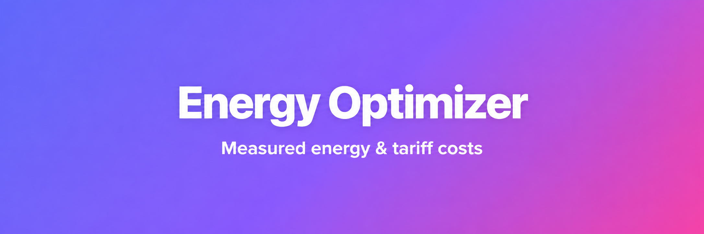
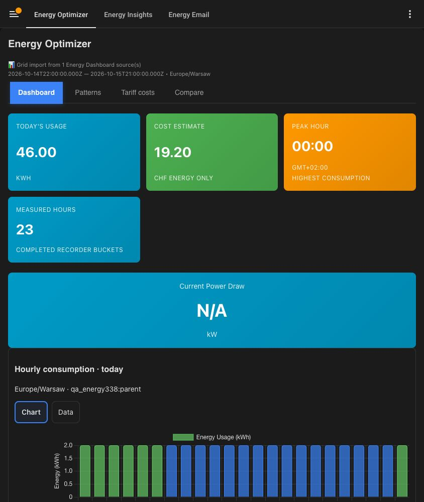
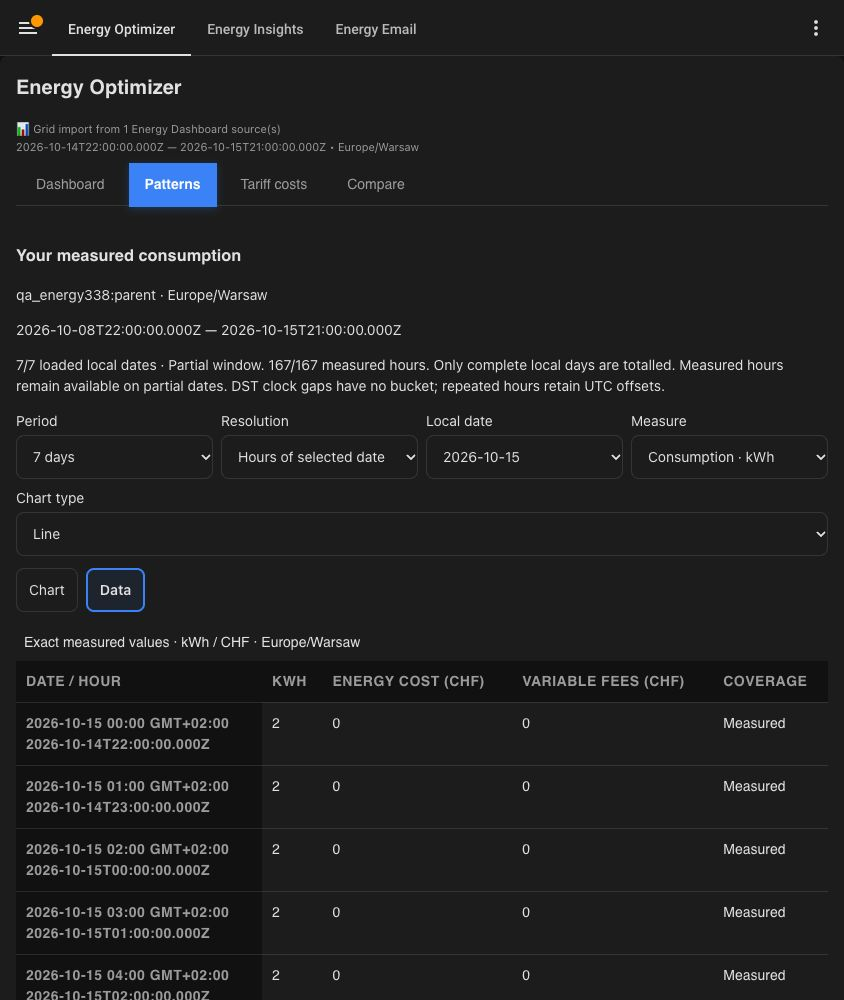
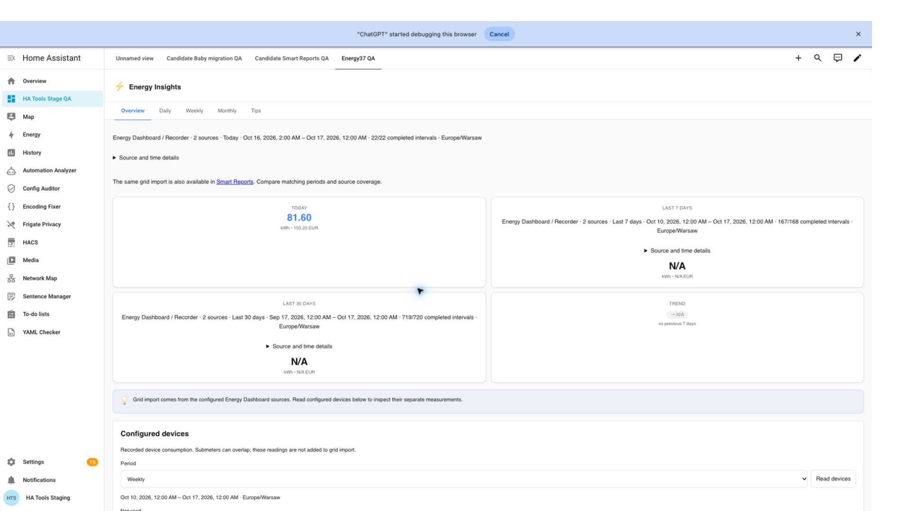
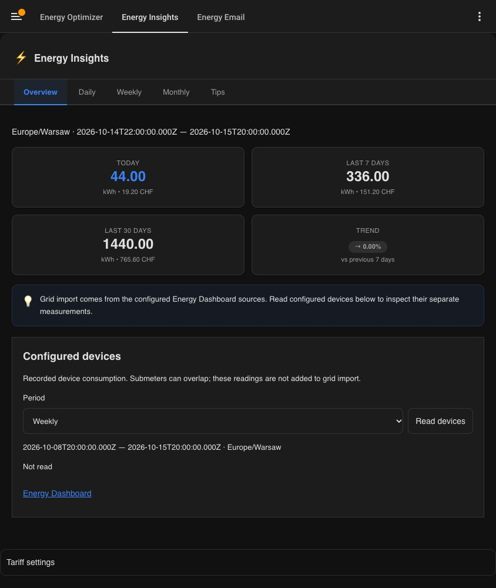
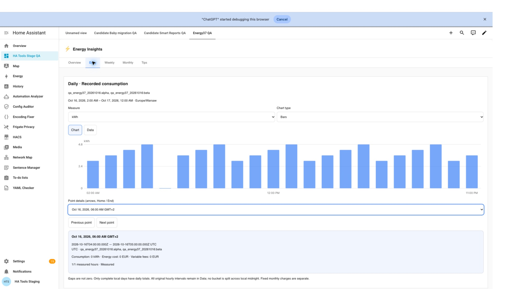
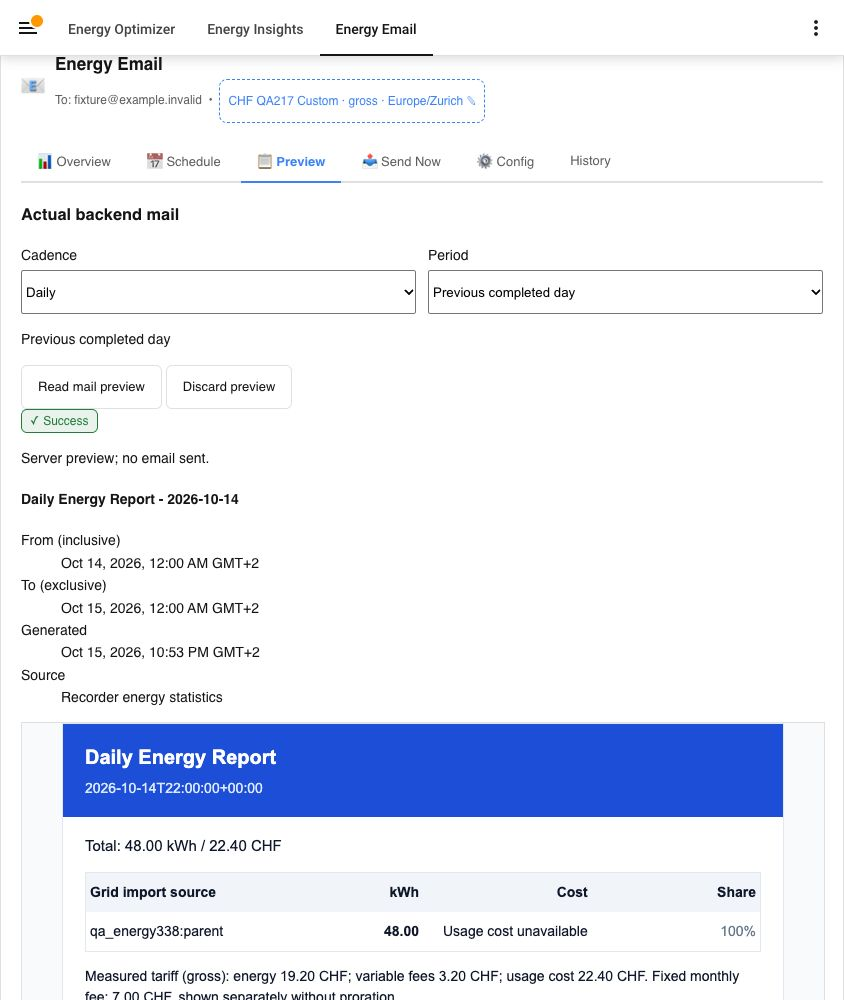
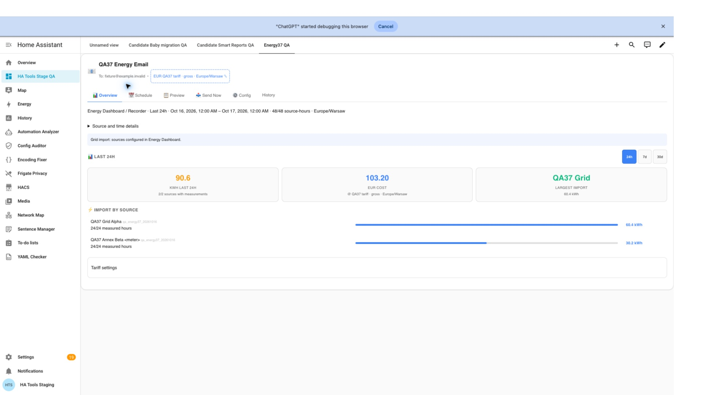
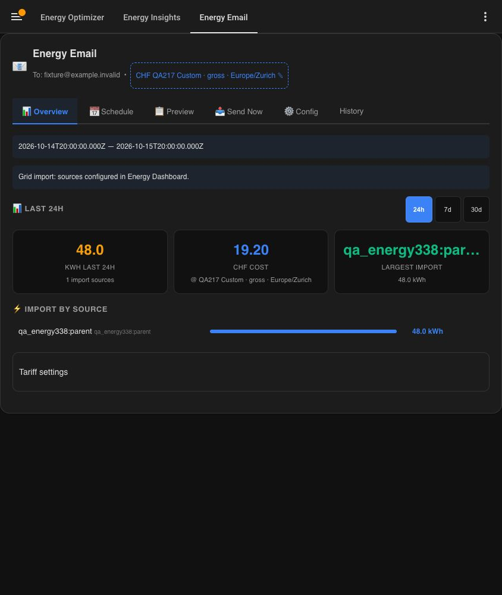

# ⚡ Energy Optimizer



Energy usage analysis for Home Assistant based on grid import configured in the Energy Dashboard. The cards display measured usage, interactive charts with matching data views, and costs calculated from your configured tariff. It needs Energy Dashboard grid import statistics to show numbers.

[](https://github.com/MacSiem/ha-energy-optimizer/releases) [](LICENSE)

Part of the [HA Tools](https://github.com/MacSiem/ha-tools-panel) collection for Home Assistant.

## How it works

1. All three cards read the **grid import statistics selected in your Energy Dashboard** using `energy/get_prefs`. They validate Recorder metadata and use the hourly `change` series. Solar production, grid export, power sensors in watts, and unrelated statistics are excluded.
2. Complete usage totals require every configured source and completed hourly bucket in the selected window. Insights and the Email overview retain available measured rows and clearly label partial coverage; recorded subsets never become complete totals or prices. Missing or invalid measurements remain gaps. No demo numbers are shown.
3. Costs use measured hourly import and an explicitly configured tariff. Energy, variable charges and fixed monthly charges are separate; this is not a complete utility bill. The tariff supplies its own currency, clock and gross/net basis. There is no load-shifting slider or hypothetical saving.
4. Live power is shown only if you set `power_entity`; the card does not sum overlapping power sensors.
5. Chart.js is bundled in the single HACS JavaScript file. There is no CDN request or extra Lovelace resource.

An interrupted first load resumes in the current online Home Assistant context after the old read settles; it does not need a period click or another state update. The overview distinguishes sources with available measurements from all configured sources. A source with unsupported energy metadata remains part of incomplete coverage.

### One repo, three cards

Since v3.3.0 this single file/repo bundles three custom elements — install
once, use any of them:

| Card type | What it adds |
|---|---|
| `custom:ha-energy-optimizer` | Dashboard with hourly Chart/Data, measured Patterns by day/hour, tariff-zone costs and consecutive-week totals. |
| `custom:ha-energy-insights` | Overview, Daily / Weekly / Monthly Chart/Data and Tips. Device measurements configured in Energy Dashboard are read only on request; parent/submeter relationships and partial coverage stay visible, and device rows are never added to the grid-import total. |
| `custom:ha-energy-email` | Recorder-backed 24h / 7d / 30d overview and report preview. Sending requires an administrator and configured SMTP in HA Tools Email. With **HA Tools Email 2.3.1+**, actual emails retain available measurements and show incomplete coverage; a partial report does not claim a complete total or cost. Actual HTML mail previews and explicit manual calendar sends require **HA Tools Email 2.3.0+**; summary/rolling compatibility supports **2.1.2+**, and calendar schedules and shared tariffs require **2.2.0+**. Legacy direct sending also validates hourly coverage. Local schedule settings are retained but do not run a server schedule. HA Tools Email & Reports 4.5.0+ forwards to this maintained card. |

### What is automatic vs. manual

| Automatic | Manual |
|---|---|
| Grid import discovery from Energy Dashboard | Configure a grid import source in Energy Dashboard |
| Measured hourly charts when Recorder data is available | Review a shared tariff in Settings, or provide an explicit `tariff_profile` / legacy card rate |
| Home Assistant theme and currency | Set `power_entity` for live power; add Insights or Email cards if wanted |
| Bundled charts | Configure the optional HA Tools Email integration and SMTP before sending mail |

### Windows and first run

Optimizer and Insights “Today” cover completed hourly buckets since local midnight in the Home Assistant timezone. Repeated DST hours keep separate absolute identities and UTC offsets; a skipped or future hour is not a measured zero. Completed days may have 23 or 25 hours. Weekly comparisons use consecutive 168-hour windows; monthly and email views use the last 720 hours. Email daily reports use the last 24 completed hours. The displayed start/end timestamps identify the window, so Today and a daily email can legitimately differ.

Accepted measurements are cleared when the HA connection, user or measurement timezone changes, and when the card loses its HA context. A new context cannot display the preceding session’s cached grid or email totals while its own measurements are pending. Language and theme changes retain the current measurements.

If local midnight falls inside an hourly Recorder aggregate (for example in a half-hour or quarter-hour timezone), the complete Today total and cost stay unavailable. The measured subset, timezone and exact interval remain visible; original hourly measurements are retained in Chart/Data without dividing a bucket. Rolling 24h / 168h / 720h reports keep their exact completed-hour windows.

The Email overview keeps valid sources when another source is missing or has incomplete history. Each row shows measured hours, while the recorded subtotal describes only those measurements. A failed refresh hides the older ranking instead of presenting stale values as the current period. A fully measured zero remains zero; an unknown tariff still leaves its price unavailable.

Wh, kWh and MWh are normalized to kWh. Unsupported units remain unavailable in all three cards. Missing sources, hours, duplicate timestamps, negative changes and unsupported metadata cannot produce a complete total. Future hours remain blank. Cost requires a configured tariff; there is no assumed electricity price.

Opening Energy Email only reads data and existing settings. It never creates helpers or automations. Explicit administrator saves use existing input_text helpers when available and browser storage otherwise. Ordinary users can read energy data; email configuration, scheduling and sending are reserved for administrators. With HA Tools Email 2.2.0+, all three cards can read the same server tariff. Administrator saves require confirmed backend readback; household users may read the profile. Card YAML tariffs remain available without the backend. A shared tariff that cannot be confirmed withholds costs rather than substituting another price.

### Measured charts and Custom tariffs

Optimizer Dashboard and Patterns, and Insights Daily / Weekly / Monthly, provide **Chart / Data** views of the same measured intervals. Units, source, timezone, coverage and missing values stay explicit. Use the point selector with arrows, Home or End for exact values without a pointer. Changing presentation does not fetch another Recorder dataset. Patterns includes a day/hour selector and weekday averages from complete local days; partial days remain partial. Insights paginates long data and device lists, with search and visible parent/submeter relationships.

The Custom tariff supports a currency, IANA timezone or an explicitly configured fixed meter clock, gross/net basis, multiple zones and minute/overnight intervals. Rules may select weekdays, seasons and dated exceptions; no country-specific weekend or holiday is assumed. An hourly measurement crossing different prices is unavailable instead of being divided by a guessed load shape. Energy cost and variable per-kWh charges are calculated separately; a fixed monthly charge is shown separately and never spread over the hourly chart. A missing variable charge does not turn into a zero charge.

### Server calendars and send history

With HA Tools Email **2.2.0+**, Energy Email can manage multiple daily, weekly or monthly calendar schedules, local sending time, weekday/month day and IANA timezone (or follow Home Assistant). The server supplies the next firing time and the previous completed calendar period. The rolling 24h / 7d / 30d overview can therefore differ from a calendar preview. Opening the editor or Preview does not send mail or create a schedule; save/delete require an administrator and confirmed readback.

Existing automations are shown separately with warnings to avoid running both a legacy automation and a server schedule for the same report. Browser-only legacy settings do not run a schedule. History reads the server's bounded attempt log; **accepted by SMTP is not proof of delivery**. An unknown result is not automatically retried. SMTP credentials remain in the backend integration.

### Actual Energy mail preview and explicit manual periods

With stable **HA Tools Email 2.3.0+**, Preview reads the actual server-composed
subject and HTML without requiring SMTP setup or device discovery. Choose daily,
weekly or monthly, then select the last 24/168/720 completed Recorder hours or
the previous completed local day, ISO week or calendar month. The card displays
actual inclusive start, exclusive end, timezone, source and data limitations.
Calendar periods follow Home Assistant's timezone for manual selection.

The Send tab shares the chosen period mode and offers a button for each cadence.
The backend composes again at send time, so new data can change the report.
Schedules keep their own recipients and timezone. Their existing rolling Send
now button is explicitly labelled; a separate previous-calendar-period button
sends that schedule's last completed calendar period. Neither action saves or
changes the schedule. New calendar sends never silently fall back to rolling
when the backend is older or unavailable.

Completed calendar reports compare with the adjacent previous calendar period
when both have complete supported measurements. Actual durations remain
visible across DST and unequal months; totals are not normalized. A zero
baseline has no percentage change. Rolling reports do not claim this calendar
comparison. Measured grid import does not establish an appliance-flow diagram.

The HTML appears in an isolated sandbox with scripts, external resources and
form actions blocked. Only administrators can read mail previews or send;
Overview remains available to household users. The compatibility energy summary
is retained separately. Legacy rolling and Quick Summary behavior remains
available in its supported older integration path. Server acceptance does not
confirm inbox delivery; an occupied send is never automatically retried.

## Screenshots

These are unedited captures from Home Assistant with controlled synthetic
Recorder statistics and sample tariffs (CHF in the earlier chart captures, PLN
in the current partial Email overview). They contain no household data or
real email recipients. The interface follows the Home Assistant light/dark theme.

| Energy Optimizer dashboard | Exact measured values |
|---|---|
|  |  |

| Insights, light | Insights, dark |
|---|---|
|  |  |

| Daily measured chart | Actual calendar mail preview |
|---|---|
|  |  |

| Email overview, light | Email overview, dark |
|---|---|
|  |  |

The captures use different explicitly displayed windows: the Optimizer shows
23 completed hours of the current day (46 kWh), the earlier Insights capture
22 hours (44 kWh), and the current Email overview a rolling 24 hours with
88 kWh recorded across 40/48 configured source-hours. Its measured source rows
remain visible while the incomplete full-period total and cost stay unavailable.
The actual mail preview
shows the previous completed calendar day. Energy charges, variable fees and
fixed monthly fees remain separate. Actual HTML previews require HA Tools Email
Integration 2.3.0 or newer; the report continues below the visible preview area.
[Capture provenance](docs/screenshots/provenance.json) records the source versions
and the view scope used by these images.

## Installation

**Energy Optimizer is in the HACS default store** — no custom repository needed:

1. Open **HACS** in Home Assistant.
2. Search for **Energy Optimizer**.
3. Install and refresh your browser.

[](https://my.home-assistant.io/redirect/hacs_repository/?owner=MacSiem&repository=ha-energy-optimizer&category=plugin)

Requires Home Assistant **2024.1.0** or newer.

### Migrating from the archived standalone Energy Insights

Do not install the archived `MacSiem/ha-energy-insights` standalone repository for new dashboards. Its public **1.0.2** release can display zero weekly or monthly consumption when history cannot be read. That zero does not establish measured zero. The archived release has not been patched for this defect; the maintained Insights card is included in this Energy Optimizer package.

1. Back up your dashboard configuration and note the old standalone resource URL.
2. Remove the old standalone Energy Insights resource from **Settings → Dashboards → Resources** before loading this package. Both register `ha-energy-insights`; leaving the older resource loaded can keep the old card active.
3. Install **Energy Optimizer** using the HACS instructions above and fully reload Home Assistant in the browser. Keep the dashboard card type `custom:ha-energy-insights`; review its configuration against the current quick start below.
4. Explicitly configure the measured **grid import statistics in Energy Dashboard**. Configure individual device measurements there too if you use the device view. Power sensors in watts, solar production and grid export are not substitutes for grid-import energy statistics.
5. Check the displayed source, interval, units and coverage against Energy Dashboard and the card's **Data** view. Missing measurements must remain gaps or a partial result; historical zeros from the standalone card are not proof of complete measurements.

Migration replaces that installation with the maintained card. This notice does not change the archived source or repair installed standalone 1.0.2 files.

### Compatibility and optional services

The **2024.1.0** minimum applies to the three frontend cards. Their required Home Assistant APIs are `energy/get_prefs`, `recorder/get_statistics_metadata` and `recorder/statistics_during_period` with hourly `change` values; these commands and request fields exist in Home Assistant Core 2024.1.0. Energy Dashboard grid-import configuration and valid Recorder sum statistics are required for measured totals. The cards use Home Assistant state, theme, locale, currency and timezone data supplied to custom cards.

This minimum is based on the Core API contract; the release's live installation and UI checks were performed on the current Home Assistant staging version, rather than on a separate 2024.1.0 instance. Use a browser supported by your Home Assistant frontend. Chart.js **4.5.1** is bundled locally with its MIT license notice.

Email delivery requires an administrator and the optional HA Tools Email integration with configured SMTP. Recorder summary previews and supported rolling sends use **2.1.2+**. Server calendar schedules and the shared tariff need **2.2.0+**; actual HTML previews and explicit manual calendar sends need stable **2.3.0+**. These integration APIs are separate from the Home Assistant Core minimum. Without compatible APIs, the local energy overview remains available; existing direct sending uses the integration's `send` service and validates hourly coverage. Settings can use existing `input_text` helpers or browser storage. Recipient discovery is best effort; set `recipient` explicitly if automatic discovery is unavailable.

### Manual / custom repository

1. HACS → the **⋮** menu → **Custom repositories** → add
   `https://github.com/MacSiem/ha-energy-optimizer` as category **Dashboard**
   (Lovelace plugin) — or download `ha-energy-optimizer.js` from the
   [latest release](https://github.com/MacSiem/ha-energy-optimizer/releases).
2. Copy to `/config/www/community/ha-energy-optimizer/`.
3. Add as a Lovelace resource:
   `/local/community/ha-energy-optimizer/ha-energy-optimizer.js` (type: `module`).

## Quick start

```yaml
type: custom:ha-energy-optimizer
# Optional settings — the card works with none of these set:
title: Energy Optimizer
currency: USD
peak_rate: 0.32
off_peak_rate: 0.14
peak_hours:
  start: 6
  end: 22
```

```yaml
# 30-day grid-import breakdown and trends:
type: custom:ha-energy-insights
```

```yaml
# Energy e-mail reports:
type: custom:ha-energy-email
```

## FAQ

**Do I have to configure anything?**
The usage cards need at least one grid import source configured in Home Assistant's Energy Dashboard, with valid Recorder sum statistics. A tariff is optional; costs show N/A until one is configured.

**Why are usage values unavailable?**
Check the Energy Dashboard grid import source and its Recorder statistics. The card does not replace missing data with sample values.

**Does it support day/night or weekday/weekend tariffs?**
Yes. Configure currency, timezone, zones, rates, minute intervals, weekdays, seasons and dated exceptions in a Custom tariff. Zero rates are valid. Costs reflect measured consumption in those intervals; the cards do not estimate hypothetical load shifting.

**Does this send data anywhere?**
No telemetry or analytics. All energy figures come from your own Home
Assistant recorder/statistics — nothing leaves your instance. Chart.js is included in the card file; charts make no external library request. If you use `ha-energy-email` with the optional HA Tools Email
integration, mail is sent through the SMTP server *you* configure — not
through any MacSiem-operated service.

**What happened to the `entities:` option?**
Older stub configs mention an `entities` list. All cards use Energy Dashboard grid import sources instead. Legacy manual device lists and exclusions do not alter the grid-import report total.

## Changelog

See [CHANGELOG.md](CHANGELOG.md).

## Support

- [Buy Me a Coffee](https://buymeacoffee.com/macsiem)
- [PayPal](https://www.paypal.com/donate/?hosted_button_id=Y967H4PLRBN8W)

The optional support link in Energy Optimizer, Insights and Email is shown only to administrators. Dismiss it in each card or set `show_support: false` in its configuration.

## License

MIT — see [LICENSE](LICENSE).

## Privacy and data

Energy analysis reads configured Energy Dashboard sources and Recorder statistics from Home Assistant. Consumption patterns can reveal household activity. Treat exported reports and screenshots as private; use synthetic series when sharing a reproduction.

See [SECURITY.md](SECURITY.md) for safe vulnerability reporting and [NOTICE](NOTICE) for licensing notices.

### Energy Email report preview

With HA Tools Email 2.1.2 or newer, Energy Email reads the server report composer
for each cadence. Preview and sending use configured Energy Dashboard grid-import
sources and the exact completed-hour Recorder window shown in the preview.
Missing or incomplete data withholds the total; missing tariff withholds cost.
When an older backend explicitly lacks the report-preview API, local previews
and manual sends use validated Recorder data through `ha_tools_email.send`.
Without that service, sending stays disabled. Creating or updating server energy
calendar schedules requires HA Tools Email 2.2.0+; existing schedules remain visible and
can be deleted. Local previews never use lifetime readings as period consumption.

The legacy direct-send path also requires complete hourly Recorder data for the configured grid-import sources. Missing data stops period sending; measured zero remains a valid report. The exact completed-hour window is included in its email content.

## Upgrade and migration

### Updating an existing installation

Keep the existing dashboard card configuration and back up the current resource and settings before updating. Energy Optimizer, Insights and Energy Email are provided by one Energy Optimizer JavaScript resource; installing another maintained copy of the Email custom element is unnecessary.

Use HACS to update Energy Optimizer, then reload the browser. Keep the resource type `module` and ensure it points to the installed Energy Optimizer file. If an older version remains visible, inspect the installed resource and refresh its cache; do not add duplicate resources or erase settings as a troubleshooting shortcut. For a manual installation, replace the JavaScript at the existing resource path. If serving a precompressed `.gz` file, replace it together with the JavaScript so both contain the same version.

All three cards now report only the grid-import sources configured in Home Assistant's Energy Dashboard. Legacy `entities` lists, device exclusions, export and solar meters do not change the grid-import report total. Configure the source in Energy Dashboard if the cards show the missing-source guidance. Missing Recorder history stays unavailable; it is not replaced with lifetime readings or demo numbers.

Optimizer and Insights Today cover completed hourly buckets since local midnight in the Home Assistant timezone. Email daily reports use the last 24 completed hours. Weekly and monthly report windows are 168 and 720 completed hours. Compare the displayed start and end timestamps when checking values: Today and a daily email can cover different windows.

Review the tariff explicitly if costs are wanted. Missing tariff, currency, measurement or rate coverage means unavailable cost; zero prices and zero measurements remain valid. The shared tariff supplies its currency and clock. Legacy `energy_price` / peak-hour card settings remain local compatibility inputs. Configure the shared tariff through the optional backend when the same profile is needed in reports and across devices.

### Email installation and report modes

The Energy card can display Recorder-backed usage without SMTP. To send reports, install HA Tools Email through HACS, add its integration under Settings → Devices & services → Add integration, then configure SMTP through that integration's Configure action. No SMTP password is stored in the Energy card configuration.

With HA Tools Email 2.2.0 or newer, administrator calendar schedule saves use the backend. Server previews are available from 2.1.2; the calendar editor deliberately stays locked on that older version. Check the matching backend schedule readback before relying on automatic reports. An unavailable backend or permission error is not evidence that the integration is missing.

Legacy direct sending requires the HA Tools Email send service, a recipient and complete Recorder data for the requested window. Without the newer backend, schedule settings saved only in the browser do not run an automatic server schedule. They stay local to that browser and origin and can be lost when browser storage is cleared.

Opening the card does not create helpers or automations. Existing `input_text` helpers remain readable. Explicit administrator settings saves use an existing helper when available and browser storage when the helper is absent. If an existing helper rejects the value or its service write fails, the card reports the failure and retains the previous setting; it does not claim a successful save or hide a conflicting browser value. Cross-device persistence must be verified through the actual helper/backend readback; a local save alone does not establish it. Keep existing helper names and values when upgrading. An explicit card recipient takes precedence over a saved helper/browser recipient; a backend default is used only when neither is set.

Ordinary users can read energy data. Configuration, scheduling and sending require an administrator. Frontend controls are only one boundary: actual backend UI/API authorization and persistence must also be tested before accepting the candidate.

### Safe validation and rollback

After an update, verify all three card types, source selection, displayed periods and units; test measured zero separately from missing or incomplete data. Verify the settings readback after browser reload and Home Assistant restart using the correct storage mode. Do not send a real household email merely to test layout; use the approved local capture scenario.

If rollback is required, restore the backed-up JavaScript and matching gzip, restore the previous resource URL, and read back both served bytes and loaded UI. Preserve existing helpers, backend schedules and browser settings. A successful rollback of files alone does not prove that a cached browser has returned to the previous version.
